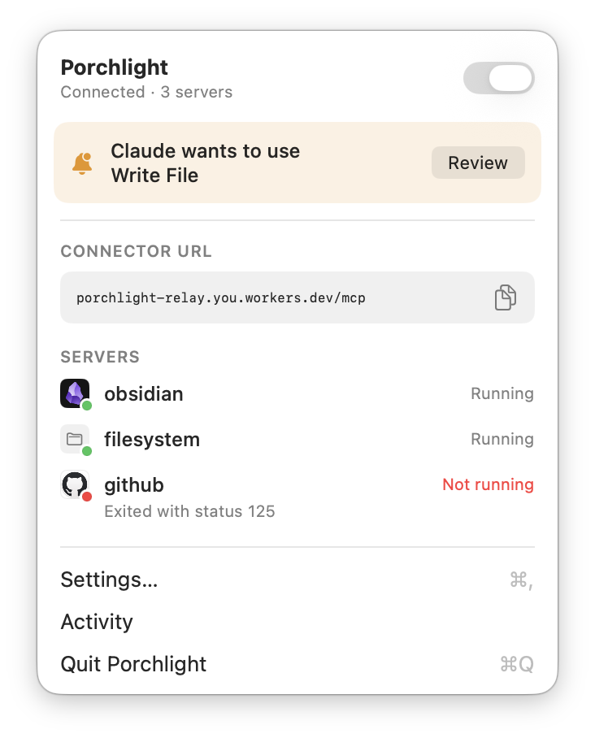
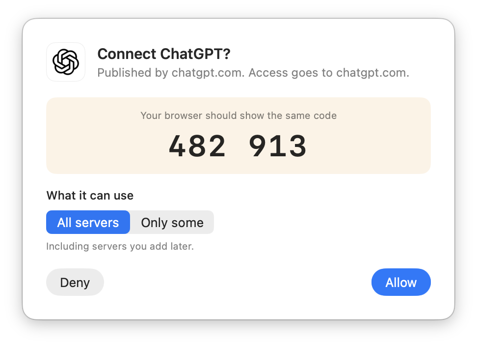
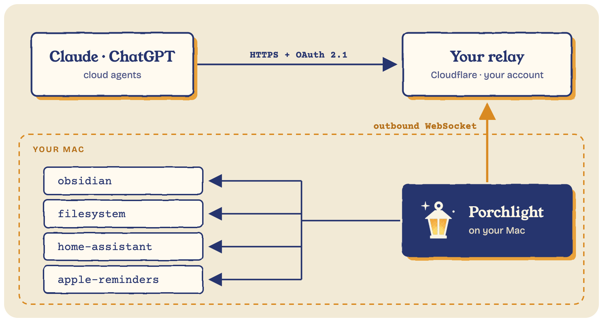

<h1 align="center">Porchlight</h1>

<p align="center">
  <strong>Leave the light on for cloud agents.</strong><br>
  Let Claude, ChatGPT and other cloud agents use the MCP servers on your Mac,<br>
  through a relay you own, with every agent and risky tool call approved by you.
</p>

<p align="center">
  <a href="LICENSE"></a>
  
  
</p>

<p align="center">
  <picture>
    <source media="(prefers-color-scheme: dark)" srcset="docs/assets/menu-waiting-dark.png">
    
  </picture>
  &nbsp;
  <picture>
    <source media="(prefers-color-scheme: dark)" srcset="docs/assets/prompt-pairing-dark.png">
    
  </picture>
</p>

---

The most useful MCP servers run on your own computer: your notes, your files, your
repos. But cloud agents like Claude.ai and ChatGPT can only reach servers on the
public internet. Tunnels like ngrok change URL every run, don't speak MCP's OAuth, and
hand every tool to anyone who finds the link.

Porchlight is a menu bar app that gives your Mac's MCP servers **one permanent,
private URL**, through a small relay that runs in **your own Cloudflare account**. Cloud
apps sign in with OAuth, you approve each one on your Mac, and anything sensitive asks
you first.

## Features

- **One URL for everything.** All your servers behind a single connector, with tools
  named `server__tool`, or one URL per server.
- **Any local server.** Commands like `npx` and `uvx` servers, and servers already
  running on your Mac, like Obsidian's. Import what you've set up in Claude Desktop
  (extensions too), Claude Code or Cursor in one click.
- **You approve every app.** Connecting shows a code in the browser and the same code on
  your Mac. Nothing gets in until you click Allow.
- **Tool permissions.** Read-only tools run right away; anything else asks first, showing
  exactly what the app wants to do. Allow once, always allow, or deny, or set any tool to
  Allow, Ask or Block.
- **Per-app access.** Give Claude everything and ChatGPT only your notes. Revoke any app
  at any time.
- **Activity.** Every request from every app, with its tool, server, duration and result.
- **One-click relay.** Porchlight deploys and updates the relay for you, on Cloudflare's
  free plan, at a `workers.dev` address. No domain needed.
- **Keeps itself up.** Restarts crashed servers and reconnects after sleep or network
  changes. No open ports: your Mac only connects out.
- **Works while your Mac sleeps.** Asking Claude to add a reminder while your Mac is off?
  The request waits, encrypted, and runs when the Mac is back.

## How it works

<p align="center">
  
</p>

1. Your Mac keeps one outbound connection open to your relay.
2. A cloud app calls the relay's URL. The relay checks its sign-in and passes the request
   to your Mac.
3. Porchlight checks what that app may use, asks you if a tool needs approval, and
   forwards the request to the right server. The answer goes back the same way.

The relay is a pipe: it keeps sign-in records, never your files, notes or tool results.
When your Mac is offline, apps still see your tools, and calls that only add something
(like creating a reminder) wait at the relay, encrypted so only your Mac can read them,
and run when it's back.

## Getting started

### Install

You need macOS 14 or later.

```sh
brew install --cask strazan/tap/porchlight
```

Or [download Porchlight](https://github.com/strazan/porchlight/releases/latest/download/Porchlight.zip),
unzip it and move it to Applications. More at [porchlight.sh](https://porchlight.sh).

### Build from source

You need Xcode.

```sh
git clone https://github.com/strazan/porchlight
cd porchlight
make app
```

### Set up

Click the lightbulb in the menu bar and follow **Set Up Porchlight…**:

1. **Deploy your relay.** Settings → Relay → **Deploy to Cloudflare…** opens a pre-filled
   page for a Cloudflare API token. Paste it back and Porchlight does the rest. You need
   a free Cloudflare account.
2. **Add servers.** Settings → Servers → **Import…** to bring in the servers you use in
   Claude Desktop, Claude Code or Cursor, or **+** to add a command or a local URL.
3. **Connect an app.** Copy the connector URL from the menu bar and add it as a custom
   connector, e.g. in Claude under **Settings → Connectors → Add custom connector**.
   Approve it on your Mac when the codes match.

Your Mac needs to be awake for cloud apps to reach your servers. Porchlight can keep it
from idle-sleeping while it's on (Settings → General).

## Security

- Apps sign in with **OAuth 2.1** (PKCE, short-lived tokens, dynamic registration and
  client metadata documents), and every new app also needs your approval on the Mac with
  a matching code.
- **No inbound connections.** Your Mac makes one outbound connection to your relay;
  nothing on your network listens to the internet.
- **Your infrastructure.** The relay runs in your Cloudflare account. There's no
  Porchlight service in between.
- Apps only see the servers you allow, blocked tools are hidden entirely, and tool calls
  that can change things ask first by default.
- Requests saved while your Mac is offline are encrypted to a key only your Mac has, kept
  for at most 7 days, and go through the same permissions when they run.

Found a security issue? Please report it privately through GitHub's
[security advisories](https://github.com/strazan/porchlight/security/advisories/new)
rather than in a public issue.

## Contributing

Issues and pull requests are welcome. [CONTRIBUTING.md](CONTRIBUTING.md) covers how the
project is laid out, running everything locally, tests and releases.

## License

[MIT](LICENSE). Porchlight isn't affiliated with Anthropic, OpenAI or Cloudflare.
