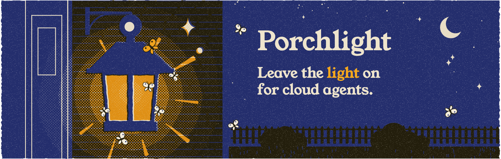

<p align="center">
  <a href="https://porchlight.sh"></a>
</p>

Claude, ChatGPT and other cloud agents can only reach MCP servers on the public internet,
but some run on your Mac: notes, files, reminders, home automation. Porchlight is a menu
bar app that gives cloud agents **one permanent, private URL** for them, through a small
relay in **your own Cloudflare account**. Apps sign in with OAuth, each one is approved on
your Mac, and tools that can change things ask first.

## Install

macOS 14 or later.

```sh
brew install --cask strazan/tap/porchlight
```

Or [download Porchlight](https://github.com/strazan/porchlight/releases/latest/download/Porchlight.zip).
Then click the lightbulb in the menu bar and choose **Set Up Porchlight…** to deploy the
relay (via a free Cloudflare account), add servers, and connect Claude or ChatGPT. The
[docs](https://porchlight.sh/docs/) cover each step with screenshots.

## How it works

<p align="center">
  
</p>

1. Your Mac keeps one outbound connection open to your relay. Nothing on your network
   listens to the internet.
2. A cloud agent calls the relay's URL. The relay checks its sign-in and passes the request
   to your Mac.
3. Porchlight checks what that app may use, asks you if a tool needs approval, and
   forwards the request to the right server. The answer goes back the same way.

The relay only passes requests through: it stores sign-in records, never files, notes or
tool results. While the Mac sleeps, calls that only add something (like creating a
reminder) wait at the relay, encrypted so only the Mac can read them, and run when it's
back.

## Docs

Setup, permissions, the offline queue and security are covered at
**[porchlight.sh/docs](https://porchlight.sh/docs/)**. Report security issues privately
through [security advisories](https://github.com/strazan/porchlight/security/advisories/new)
(see [SECURITY.md](SECURITY.md)).

## Contributing

Building from source requires Xcode:

```sh
git clone https://github.com/strazan/porchlight
cd porchlight
make app
```

[CONTRIBUTING.md](CONTRIBUTING.md) covers the project layout, running everything locally,
tests and releases.

## License

[MIT](LICENSE). Porchlight isn't affiliated with Anthropic, OpenAI or Cloudflare.
